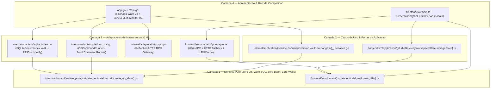

# Writtt v0.2.0 — Arquitetura Hexagonal em 4 Camadas & Cofre Zero-Knowledge

Este documento descreve a arquitetura de engenharia do **Writtt**, estúdio editorial independente local-first e cofre criptográfico Zero-Knowledge open-source, construído com **Go + Wails v3**, **`matz-core`** e **`@matz/ui`**.

---

## 1. Visão Arquitetural (4 Camadas com Inversão Estrita de Dependência)

Tanto o backend Go quanto o frontend TypeScript obedecem rigorosamente à **Arquitetura Hexagonal / Clean Architecture em 4 Camadas**, onde todas as dependências apontam exclusivamente para dentro (em direção ao Domínio Puro) e os adaptadores concretos são injetados apenas na raiz de composição (`app.go` e `main.ts`):



---

## 2. Estrutura Física de Diretórios

```text
writtt/
├── main.go                                     # Bootstrap Wails v3 (Frameless Window + OnShutdown RAM zeroization)
├── app.go                                      # Camada 4 (Go): Fachada Wails v3, Janela Destacada IA e Dialogos do SO
├── app_test.go                                 # Suite de integracao da fachada, CheckForUpdates e gateway RPC HTTP
├── internal/
│   ├── domain/                                 # Camada 1 (Go): Dominio Puro (Zero I/O, Zero SQL, Zero Wails)
│   │   ├── entities.go                         # Entidades imutaveis, Value Objects, OllamaChatMessage e ReleaseUpdateDTO
│   │   ├── ports.go                            # Porta Hexagonal pura CommandRunner (I/O, Rede release e Ollama)
│   │   ├── validation.go                       # Validacao ULID/path-traversal, SemVer CompareSemVer, FTS5, Entropia, @alias
│   │   ├── editorial.go                        # Capitulos H1-H3, DAG topologico, deteccao de ciclos, Diff, Parser IA
│   │   ├── security_rules.go                   # Sanitizer Zero-Knowledge para IA, lockout HMAC e protocolo ZKP Schnorr
│   │   ├── rag.go                              # Chunking semantico e busca vetorial L2 Cosine Similarity offline
│   │   ├── xhtml.go                            # Conversor Markdown/GFM -> XHTML estrito para EPUB 3.0 e HTML5
│   │   ├── domain_test.go                      # Testes unitarios deterministicos do dominio
│   │   └── version_test.go                     # Testes unitarios do comparador SemVer de atualizacoes
│   ├── application/                            # Camada 2 (Go): Casos de Uso & Motores Algoritmicos (Zero import de adapters)
│   │   ├── service.go                          # WritttService, CheckForUpdates, ciclo de vida e telemetria forense
│   │   ├── document_usecases.go                # CRUD, AutoSave, Subcapitulos em branco, Duplicacao, arvore e dicionario
│   │   ├── version_usecases.go                 # Ledger imutavel de versoes, Diff LCS e Certificado SHA-256 de Autoria
│   │   ├── vault_usecases.go                   # Argon2id + AES-256-GCM via Saga, PIN, Recovery Key, TOTP 2FA, HumanProof
│   │   ├── exchange_usecases.go                # Envelopes hibridos RSA-2048 OAEP, Drive E2EE, .writttpack, EPUB 3.0
│   │   ├── ai_usecases.go                      # Chat Editorial + Chatbot livre Ollama em sandbox somente-texto + RAG
│   │   └── service_test.go                     # Testes de aplicacao 100% em memoria via MockCommandRunner
│   └── adapters/                               # Camada 3 (Go): Isolamento de Plataforma & Infraestrutura
│       ├── platform_hal.go                     # Implementacoes OSCommandRunner e MockCommandRunner de domain.CommandRunner
│       ├── sqlite_index.go                     # SQLiteSearchIndex (WAL + FTS5 com SQL isolado em constantes, sem globais)
│       ├── http_rpc.go                         # HTTPRPCGateway via reflexao tipada + servidor seguro de anexos/SVG
│       ├── platform_hal_test.go                # Testes do HAL e cliente HTTP local
│       └── adapters_gateway_test.go            # Testes de seguranca FTS5 Zero-Knowledge, fsnotify e RPC HTTP
└── frontend/src/
    ├── domain/                                 # Camada 1 (TS): Dominio Puro (Zero DOM, Zero IPC, Zero localStorage)
    │   ├── models.ts                           # Contratos tipados de dominio, preferencias e ReleaseUpdateDTO
    │   ├── editorial.ts                        # Extracao de capitulos, arvore anti-ciclos, entropia e ponte Chatbot->Editor
    │   ├── markdown.ts                         # Renderizador vetorial SVG e preview Markdown/GFM sem emojis
    │   ├── i18n.ts                             # Internacionalizacao reativa (pt-BR, en-US, es-ES) via @matz/ui
    │   ├── index.ts                            # Barrel de exportacao da camada de dominio
    │   └── domain.test.ts                      # Suite Vitest do dominio puro
    ├── application/                            # Camada 2 (TS): Portas, Estado da Estacao & Persistencia Segura
    │   ├── studioGateway.ts                    # Porta StudioGatewayPort desacoplando Presentation de Adapters
    │   ├── workspaceState.ts                   # Estado explicito da estacao editorial
    │   ├── storageStore.ts                     # AISessionRepository (sessoes do Cofre estritamente em RAM volatil)
    │   └── storageStore.test.ts                # Suite Vitest validando isolamento de sessoes do Cofre
    ├── adapters/                               # Camada 3 (TS): Ponte IPC Resiliente
    │   └── ipcAdapter.ts                       # Cliente Wails v3 + fallback HTTP transparente + LRUCache O(1)
    ├── presentation/                           # Camada 4 (TS): Componentes Visuais Modulares Independentes
    │   ├── dom/domUtils.ts                     # Utilitarios compartilhados de escape HTML, hover tooltips e split-resizers
    │   ├── shell/                              # TopMenuBar, TitleBarNav standalone, EditorSidebar, StatusBar, LockScreen
    │   ├── editor/                             # TiptapStudio (ProseMirror + Slash + Inline /ai + Diff Flash) e EditorStageView
    │   ├── modals/                             # OnboardingModal e DrawingModal (Canvas Vetorial SVG)
    │   └── views/                              # HomeView, InspectorPanel (3 abas), AIStudioPanel, HelpView e settings/
    ├── styles/writtt.css                       # Design System Specular Obsidian & Architectural Alabaster
    └── main.ts                                 # Raiz de composicao, ponte multi-janela e controlador de atalhos
```

---

## 3. Invariantes de Segurança Zero-Knowledge, Isolamento de IA e Atualizações

1. **Derivação e Cifragem Autenticada**: Senha Mestra derivada via **Argon2id** (`m=64MB, t=3, p=2, keyLen=32`) + **AES-256-GCM** (`enc:`) com rotação transacional atômica (`ExecuteSaga`) sobre manuscritos, segredo TOTP e arquivos do Cofre de Arquivos.
2. **Isolamento Estrito no Índice SQLite FTS5**: `SQLiteSearchIndex.SyncDocument` grava `content = ""` na tabela virtual `documents_fts` sempre que `IsVault == true` ou `Encrypted == true`. O texto plano de obras protegidas jamais toca o disco fora do bloco cifrado AES-256-GCM.
3. **PIN Rápido Consciente de Sessão (`vault_pin_ready`) & Desbloqueio Zero-Hint Anti-Automação**: Em inicialização a frio, o Writtt exige a Senha Mestra completa para reconstruir a chave na memória RAM; em bloqueios intermediários (`Ctrl+L` ou inatividade), o PIN rápido torna-se disponível. As telas de desbloqueio operam sob política **Zero-Hint** (sem mensagens instrutivas ou distinção de erro). Tentativas incorretas aplicam espera progressiva persistida em disco (`2ª falha -> 20s`, `3ª+ falha -> 60s`) selada com `HMAC-SHA256`. O endpoint `BeginAuthChallenge` + `UnlockWithHumanProof` combina assinatura `HMAC-SHA256`, `ReplayWindow` de 64 bits, `GCRALimiter`, `WelfordCUSUM`, cinemática de digitação (`event.isTrusted`) e confirmação tátil com janela alvo randomizada contra scripts automatizados.
4. **Zeragem Determinística de Chaves (`Shutdown`)**: No encerramento do aplicativo, `WritttService.Shutdown()` executa flush do `WriteBehindCoalescer`, sobrescreve `activePassword` e `storedVaultKey` byte a byte com zeros (`zeroBytes`) e fecha o pool SQLite WAL.
5. **Estúdio IA & RAG Dedicado em Sandbox Somente-Texto**: `ChatWithAssistant` e `FreeChatWithAssistant` comunicam-se apenas via texto puro com o Ollama local (`127.0.0.1:11434`), sem tool-calling e sem acesso a arquivos ou terminal. O contexto passa por `SanitizeContextForAI` (redação automática de segredos por entropia de Shannon), respostas do Chatbot podem ser selecionadas e encaminhadas com precisão ao Editor IA, e o painel pode operar acoplado, flutuante sobre a janela ou destacado em janela nativa independente do SO para segundo monitor.
6. **Verificação Privada de Atualizações (`CheckForUpdates`)**: Consulta apenas o manifesto público (`https://www.writtt.com/version.json` com fallback para `https://api.github.com/repos/marcelomatz/writtt/releases/latest`), comparando versões via `domain.CompareSemVer` sem transmitir telemetria ou identificadores da máquina.

---

## 4. Aplicação dos 8 Módulos de Algoritmos

| Módulo | Estrutura / Algoritmo | Aplicação Concreta no Writtt |
| :--- | :--- | :--- |
| **1. Containers** | `LRUCache[K,V]` + `RingBuffer[T]` | Cache $O(1)$ com TTL para documentos abertos (limpo ao selar o cofre) e buffer circular de telemetria. |
| **2. Graph** | `TopologicalSort` + `CascadeRestartPlan` | Ordenação topológica (Kahn), ondas paralelas, cálculo de impacto e bloqueio de ciclos na árvore Pai/Subcapítulos. |
| **3. Concurrency** | `StripedLockManager` + `ExecuteSaga` + `WriteBehindCoalescer` | Exclusão mútua por documento com `FencingToken` monotônico, rotação atômica de Senha Mestra com compensação reversa e escrita coalescida. |
| **4. RateLimit** | `GCRALimiter` | Controle $O(1)$ por agendamento virtual TAT contra rajadas de chamadas IPC e tentativas de autenticação. |
| **5. Anomaly** | `ShannonEntropy` + `WelfordCUSUM` | Redação automática de chaves/segredos de alta entropia antes do envio à IA + monitoramento estatístico CUSUM de latência e cadência. |
| **6. Sampling** | `AliasSampler` (Vose) | Amostragem ponderada em tempo constante $O(1)$ de subsistemas auditados. |
| **7. Crypto** | `ForensicChain` SHA-256 + `ReplayWindow` + `HMACSHA256` + `Joaat` | Cadeia forense imutável verificável (`Verify()`), certificados de autoria pré-publicação, anti-replay de 64 bits para TOTP RFC 6238 e desafios ZKP. |
| **8. Spatial** | `SpatialGrid` | Indexação espacial 2D dos documentos do workspace para telemetria estrutural. |
